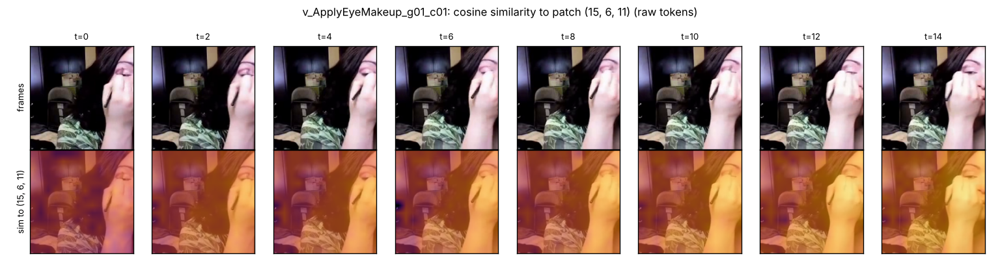

# Example figures

What `scripts/visualize_tokens.py` should give you on one UCF101 clip,
`UCF-101/ApplyEyeMakeup/v_ApplyEyeMakeup_g01_c01.avi` (open the video and
watch it first). Use these to check your own implementation, then go and look
at other clips and classes.

The clip is sampled as in `configs/model.yaml`: 16 frames at about 7.5 fps
from the middle of the video. Every second frame is shown.

## CLS attention

```bash
python scripts/visualize_tokens.py --video <UCF101>/UCF-101/ApplyEyeMakeup/v_ApplyEyeMakeup_g01_c01.avi --layer 5
python scripts/visualize_tokens.py --video <UCF101>/UCF-101/ApplyEyeMakeup/v_ApplyEyeMakeup_g01_c01.avi --layer -1
```

| | |
|---|---|
|  | **Layer 5.** In the first frames the CLS spreads its attention over the scene; as the clip goes on it settles on the hand and the brush near the eye. The share of attention on the face/hand region grows from about 30% to 38% of each frame (that region is 26% of the image). |
|  | **Last layer.** Much more diffuse, and a large part of the attention goes to the first frame (about 16% on frame 0 alone, against ~6% for a uniform split over 16 frames). Try `per_frame=False` in `cls_attention_maps` to see it. |

## Patch tokens: PCA

| | |
|---|---|
|  | **PCA over the whole clip.** The colours mostly change from frame to frame, not from object to object. The first components encode *when* a token is (how many frames it has seen under block-causal attention), not *what* it shows. |
|  | **PCA after removing each frame's mean token.** Now the face and hand form one region, separate from the background and the clothes, and stay the same colour across frames. Frame 0 is noisier: its tokens have seen only one frame. |

PCA has a random sign per component, so your colours can be swapped or
inverted. The regions should be the same.

## Patch tokens: similarity to one patch

```bash
python scripts/visualize_tokens.py --video <UCF101>/UCF-101/ApplyEyeMakeup/v_ApplyEyeMakeup_g01_c01.avi --layer 5 --query 15 6 11
```

The query is patch (t=15, row 6, column 11): the hand holding the brush in the
last frame.

| | |
|---|---|
|  | **Raw tokens.** Almost everything is similar to the query, and more so in later frames. Like the whole-clip PCA, this is mostly time. |
|  | **Per-frame mean removed.** The hand and face light up and the background goes dark, and the contrast grows as the clip goes on (face/hand minus background: 0.20 at t=0, 0.43 at t=15). Part of that growth is the object, part is that later frames share more context with the query frame. |

## What to take from this for the readout

- The CLS token does look at the action, but mostly in the middle layers; in the
  last layer it is spread out.
- The patch tokens clearly know where the person and the hands are, but every
  token also carries "how far into the clip am I". A plain mean over all 3136
  tokens mixes the two.
