# Example figures

What `scripts/visualize_tokens.py` should give you on two UCF101 clips. Use
them to check your own implementation of the two TODO functions, then go and
look at other clips and classes.

| Clip | Path inside UCF101 | What happens |
|---|---|---|
| Eye makeup | `UCF-101/ApplyEyeMakeup/v_ApplyEyeMakeup_g01_c01.avi` | Close-up, a hand brushes makeup onto an eye |
| Baby crawling | `UCF-101/BabyCrawling/v_BabyCrawling_g19_c02.avi` | Wide shot, a baby crawls across a wooden floor |

Watch both videos before looking at the figures.

## Getting the clips

If you have UCF101, use the paths above. If not (yet), download just these two
clips (about 170 MB, from a public UCF101 subset on the Hugging Face Hub):

```bash
python scripts/download_example_clips.py      # saves them in data/examples/
```

The model itself is downloaded automatically the first time you run any script
that uses it.

Each clip is sampled as in `configs/model.yaml`: 16 frames at about 7.5 fps
from the middle of the video. Every second frame is shown. PCA has a random
sign per component, so your colours can be swapped or inverted; the regions
should be the same.

## Clip 1: ApplyEyeMakeup

```bash
python scripts/visualize_tokens.py --video data/examples/v_ApplyEyeMakeup_g01_c01.avi --layer 5 --query 15 6 11
python scripts/visualize_tokens.py --video data/examples/v_ApplyEyeMakeup_g01_c01.avi --layer -1
```

The query patch (t=15, row 6, column 11) is the hand holding the brush in the
last frame.

| | |
|---|---|
| 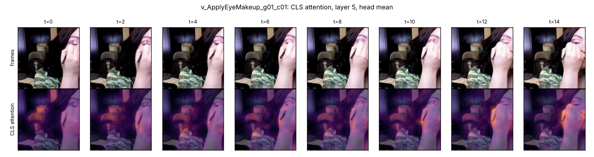 | **CLS attention, layer 5.** In the first frames the CLS spreads its attention over the scene; as the clip goes on it settles on the hand and the brush near the eye. The share of attention on the face/hand region grows from about 30% to 38% of each frame (that region is 26% of the image). |
| 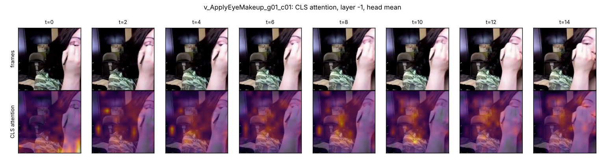 | **CLS attention, last layer.** Much more diffuse, and a large part of the attention goes to the first frame (about 16% on frame 0 alone, against ~6% for a uniform split over 16 frames). Try `per_frame=False` in `cls_attention_maps` to see it. |
| 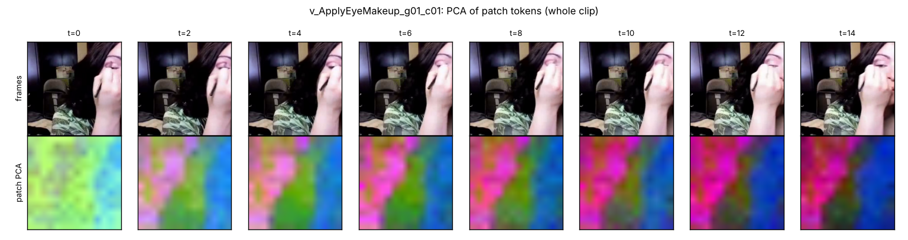 | **PCA over the whole clip.** The colours mostly change from frame to frame, not from object to object. The first components encode *when* a token is (how many frames it has seen under block-causal attention), not *what* it shows. |
| 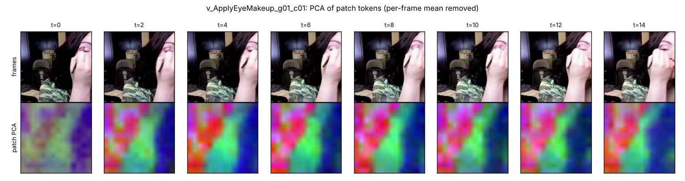 | **PCA after removing each frame's mean token.** Now the face and hand form one region, separate from the background and the clothes, and stay the same colour across frames. Frame 0 is noisier: its tokens have seen only one frame. |
|  | **Similarity to the hand, raw tokens.** Almost everything is similar to the query, and more so in later frames. Like the whole-clip PCA, this is mostly time. |
| 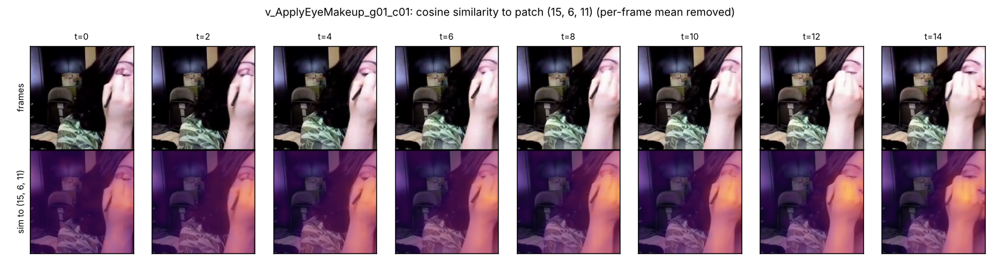 | **Similarity to the hand, per-frame mean removed.** The hand and face light up and the background goes dark, and the contrast grows as the clip goes on (face/hand minus background: 0.20 at t=0, 0.43 at t=15). |

## Clip 2: BabyCrawling

```bash
python scripts/visualize_tokens.py --video data/examples/v_BabyCrawling_g19_c02.avi --layer 16 --query 15 7 7
python scripts/visualize_tokens.py --video data/examples/v_BabyCrawling_g19_c02.avi --layer -1
```

The query patch (t=15, row 7, column 7) is the baby's body in the last frame.

| | |
|---|---|
| 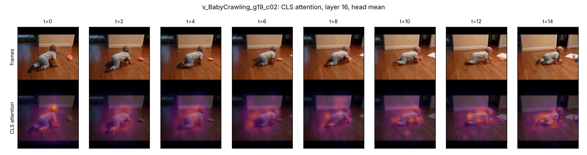 | **CLS attention, layer 16.** Follows the baby through the whole clip: the head in the first frame, then the body and hands as it crawls. About half of each frame's attention is on the box around the baby, which covers a quarter of the image. Here layer 5 mostly looks at the wall, so the useful layer depends on the clip. |
| 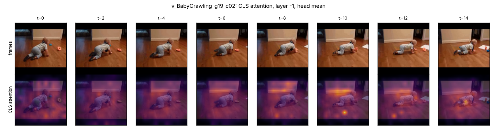 | **CLS attention, last layer.** Spread over the floor and wall at first, then it closes in on the baby's hands and knees in the last frames: the share on the baby goes from 29% at t=0 to 46% at t=15. Frame 0 again gets a large share of the total (about 22%). |
| 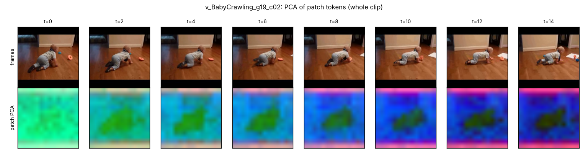 | **PCA over the whole clip.** The baby is faintly visible, but the dominant change is the colour of everything drifting from frame to frame: time again. |
| 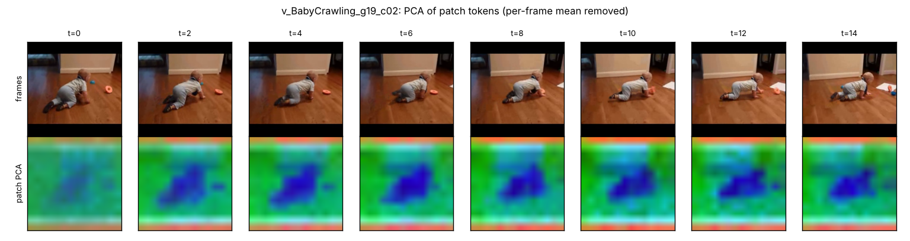 | **PCA after removing each frame's mean token.** The baby is one clean region, separate from the floor and the wall, and keeps its colour as it moves. |
| 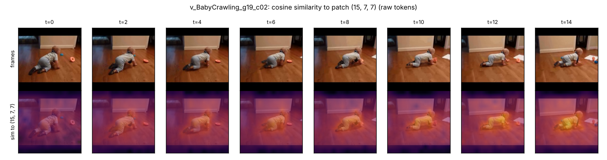 | **Similarity to the baby, raw tokens.** Mostly a time gradient, no clear object. |
| 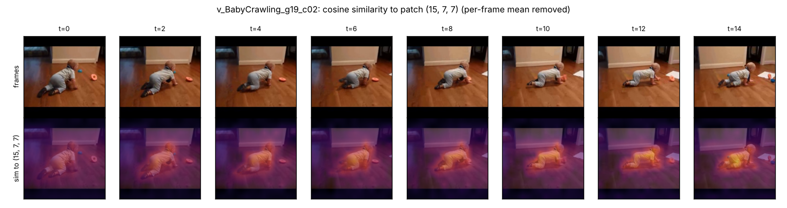 | **Similarity to the baby, per-frame mean removed.** The baby lights up in every frame and follows it as it crawls, getting sharper towards the end of the clip. |

Part of the growth over time in the similarity maps is the object, part is that
later frames have seen more of the same clip as the query (which is in the last
frame). Keep that in mind when you interpret them.

## What to take from this for the readout

- The CLS token does look at the action, but which layer shows it best depends
  on the clip, and in the last layer it is often spread out and leans on the
  first frame.
- The patch tokens clearly know where the person, the hands or the baby are,
  but every token also carries "how far into the clip am I". A plain mean over
  all 3136 tokens mixes the two.
