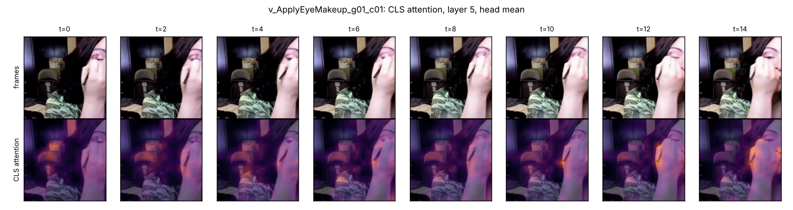
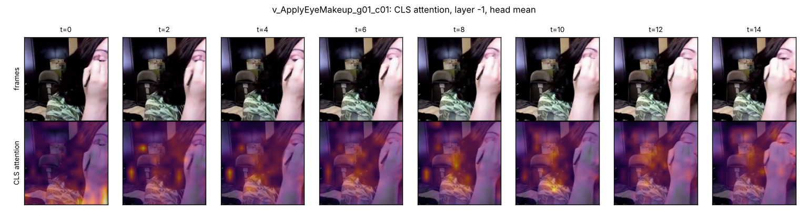
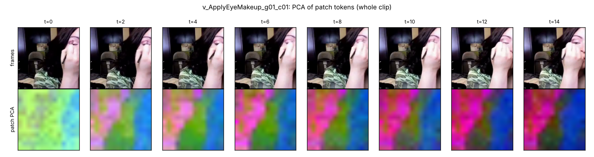
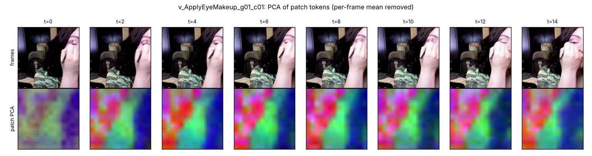
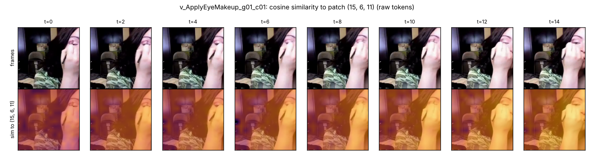
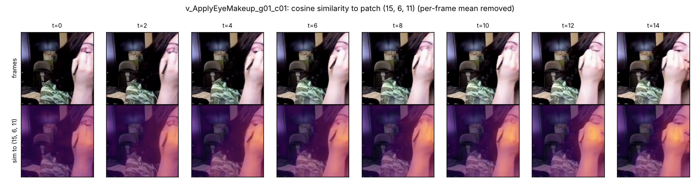

# ApplyEyeMakeup: v_ApplyEyeMakeup_g01_c01

`UCF-101/ApplyEyeMakeup/v_ApplyEyeMakeup_g01_c01.avi`.

16 frames at about 7.5 fps from the middle of the video, every second frame
shown. See [../README.md](../README.md) for how to get the clip.

```bash
python scripts/visualize_tokens.py --video data/examples/v_ApplyEyeMakeup_g01_c01.avi --layer 5 --query 15 6 11
python scripts/visualize_tokens.py --video data/examples/v_ApplyEyeMakeup_g01_c01.avi --layer -1
```

The query patch (t=15, row 6, column 11) is the hand holding the brush in the
last frame.

| | |
|---|---|
|  | **CLS attention, layer 5.** In the first frames the CLS spreads its attention over the scene; as the clip goes on it settles on the hand and the brush near the eye. The share of attention on the face/hand region grows from about 30% to 38% of each frame (that region is 26% of the image). |
|  | **CLS attention, last layer.** Much more diffuse, and a large part of the attention goes to the first frame (about 16% on frame 0 alone, against ~6% for a uniform split over 16 frames). Try `per_frame=False` in `cls_attention_maps` to see it. |
|  | **PCA over the whole clip.** The colours mostly change from frame to frame, not from object to object. The first components encode *when* a token is (how many frames it has seen under block-causal attention), not *what* it shows. |
|  | **PCA after removing each frame's mean token.** Now the face and hand form one region, separate from the background and the clothes, and stay the same colour across frames. Frame 0 is noisier: its tokens have seen only one frame. |
|  | **Similarity to the hand, raw tokens.** Almost everything is similar to the query, and more so in later frames. Like the whole-clip PCA, this is mostly time. |
|  | **Similarity to the hand, per-frame mean removed.** The hand and face light up and the background goes dark, and the contrast grows as the clip goes on (face/hand minus background: 0.20 at t=0, 0.43 at t=15). |

PCA has a random sign per component, so your colours can be swapped or
inverted; the regions should be the same.

Part of the growth over time in the similarity maps is the object, part is that
later frames have seen more of the same clip as the query (which is in the last
frame). Keep that in mind when you interpret them.
