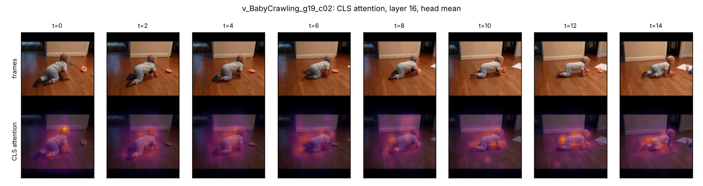
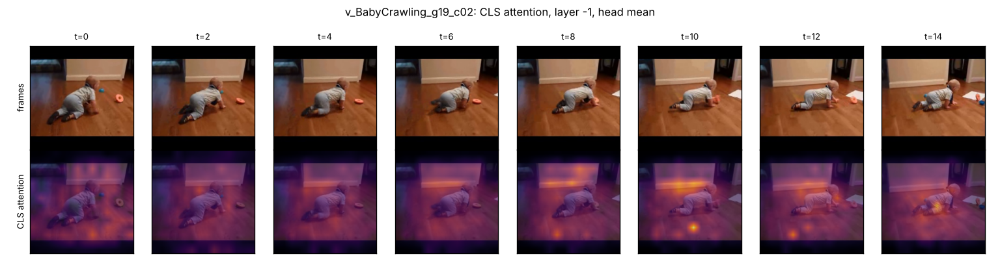
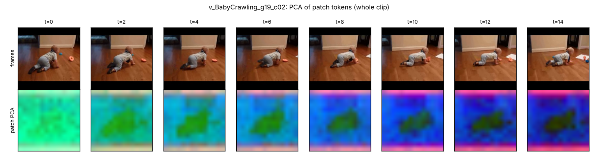
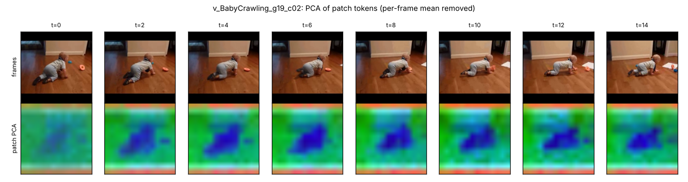
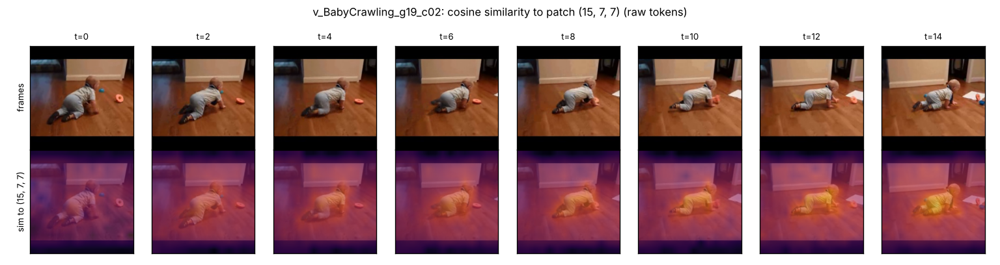
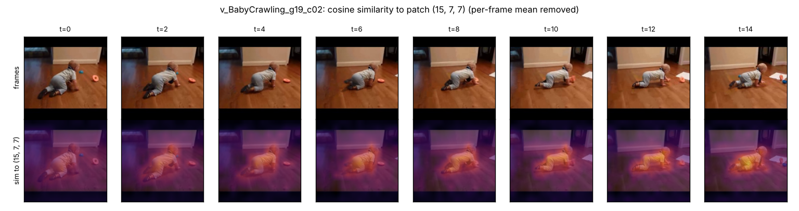

# BabyCrawling: v_BabyCrawling_g19_c02

`UCF-101/BabyCrawling/v_BabyCrawling_g19_c02.avi`.

16 frames at about 7.5 fps from the middle of the video, every second frame
shown. See [../README.md](../README.md) for how to get the clip.

```bash
python scripts/visualize_tokens.py --video data/examples/v_BabyCrawling_g19_c02.avi --layer 16 --query 15 7 7
python scripts/visualize_tokens.py --video data/examples/v_BabyCrawling_g19_c02.avi --layer -1
```

The query patch (t=15, row 7, column 7) is the baby's body in the last frame.

| | |
|---|---|
|  | **CLS attention, layer 16.** Follows the baby through the whole clip: the head in the first frame, then the body and hands as it crawls. About half of each frame's attention is on the box around the baby, which covers a quarter of the image. Here layer 5 mostly looks at the wall, so the useful layer depends on the clip. |
|  | **CLS attention, last layer.** Spread over the floor and wall at first, then it closes in on the baby's hands and knees in the last frames: the share on the baby goes from 29% at t=0 to 46% at t=15. Frame 0 gets a large share of the total (about 22%). |
|  | **PCA over the whole clip.** The baby is faintly visible, but the dominant change is the colour of everything drifting from frame to frame: that is time, not content. |
|  | **PCA after removing each frame's mean token.** The baby is one clean region, separate from the floor and the wall, and keeps its colour as it moves. |
|  | **Similarity to the baby, raw tokens.** Mostly a time gradient, no clear object. |
|  | **Similarity to the baby, per-frame mean removed.** The baby lights up in every frame and follows it as it crawls, getting sharper towards the end of the clip. |

PCA has a random sign per component, so your colours can be swapped or
inverted; the regions should be the same.

Part of the growth over time in the similarity maps is the object, part is that
later frames have seen more of the same clip as the query (which is in the last
frame). Keep that in mind when you interpret them.
